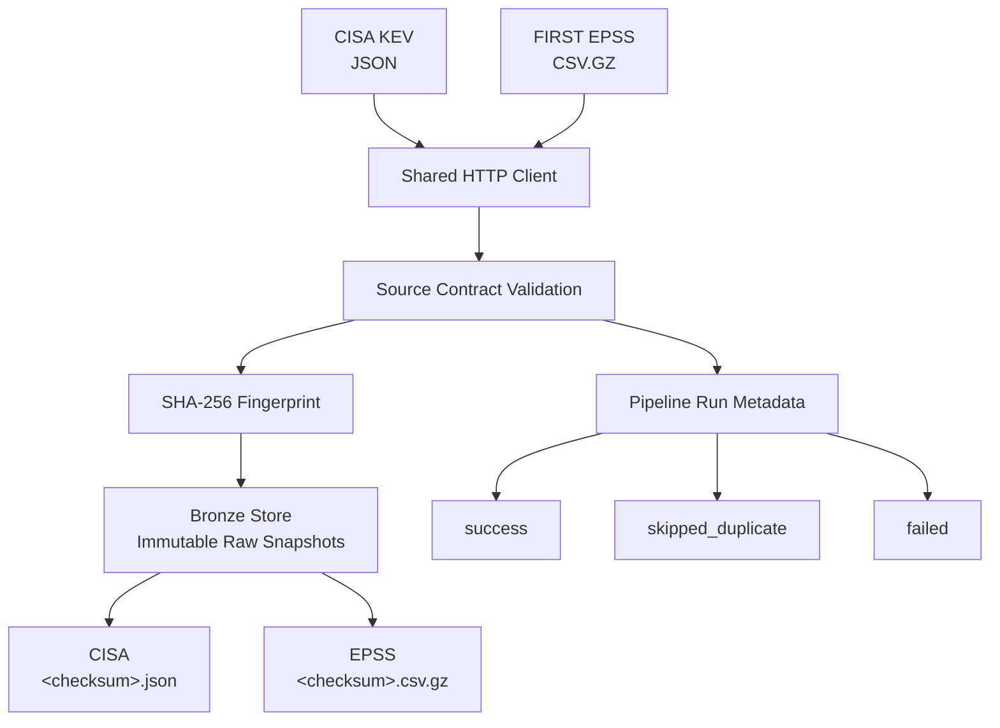
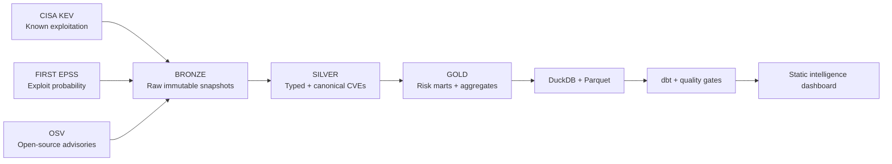
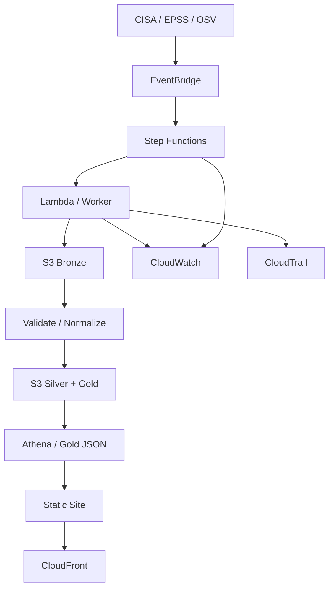

# VulnLake

**A vulnerability-intelligence data platform that turns fragmented public security data into reproducible, auditable and eventually cloud-native risk intelligence.**


> VulnLake is being built as a production-shaped portfolio project spanning data engineering, cloud architecture, DevSecOps and cybersecurity.  
> The current system runs locally and already provides tested, idempotent Bronze ingestion for CISA KEV and FIRST EPSS. The roadmap extends this foundation into Silver/Gold analytics, OSV enrichment, AWS-shaped orchestration, observability and Infrastructure as Code.

---

## Why VulnLake exists

Vulnerability management data is fragmented across sources that answer different questions.

- **CISA KEV** identifies vulnerabilities known to be exploited in the wild.
- **FIRST EPSS** estimates the probability that a CVE will be exploited.
- **OSV** provides vulnerability intelligence for open-source packages and ecosystems.

Individually, these feeds are useful.

Together, they can answer a more practical question:

> **Which vulnerabilities deserve attention first, and why?**

VulnLake is designed to ingest these sources safely, preserve their provenance, normalize them into analytical models, and eventually expose transparent risk intelligence through reproducible local and cloud execution paths.

It is deliberately not another CRUD application. The engineering focus is on:

- data ingestion
- source contracts
- idempotency
- provenance
- failure handling
- data quality
- analytical modeling
- automation
- infrastructure
- cloud security
- observability

---

# Current status

VulnLake is under active development.

## Implemented

- CISA Known Exploited Vulnerabilities ingestion
- FIRST EPSS bulk-score ingestion
- shared HTTP source client
- bounded retry behaviour
- exponential backoff
- redirect handling
- source-contract validation
- immutable Bronze snapshots
- SHA-256 source fingerprinting
- content-addressed storage
- pipeline-run metadata
- duplicate-source detection
- failed-run observability
- deterministic source fixtures
- unit tests
- integration tests
- Ruff static analysis
- command-line interface
- Makefile development commands
- Git-safe local data storage

## Next

- OSV ingestion
- canonical CVE Silver model
- source deduplication and aliases
- Parquet storage boundaries
- DuckDB analytical storage
- dbt transformations and model tests
- Gold vulnerability-risk snapshots
- freshness and schema-drift checks
- volume anomaly detection
- static vulnerability-intelligence dashboard

## Later cloud evolution

- local AWS emulation
- S3 Bronze / Silver / Gold storage
- EventBridge scheduling
- Step Functions orchestration
- Lambda or worker-based ingestion
- CloudWatch observability
- CloudTrail audit evidence
- Terraform infrastructure
- CI/CD infrastructure validation
- selective real-AWS validation

---

# Architecture

## Current local architecture



The Bronze layer preserves the exact source representation.

CISA remains JSON.

EPSS remains gzip-compressed CSV.

Parsing is used to **validate** a source before promotion into the valid Bronze snapshot namespace; it does not destructively rewrite the original source.

---

# Target data architecture



The layers have deliberately different responsibilities.

### Bronze

**Purpose:** preserve source truth.

Contains:

- original source payload
- checksum
- source version
- source release timestamp
- ingestion-run metadata

Does not contain:

- risk scoring
- dashboard formatting
- destructive normalization
- cross-source joins

### Silver

**Purpose:** establish analytical truth.

Planned responsibilities:

- canonical CVE identifiers
- typed timestamps
- normalized fields
- deduplication
- OSV aliases
- source lineage
- Parquet boundaries

### Gold

**Purpose:** produce actionable security intelligence.

Planned outputs include:

- vulnerability risk snapshots
- KEV event history
- EPSS enrichment
- vendor risk summaries
- ecosystem summaries
- transparent vulnerability-priority calculations
- dashboard-ready aggregates

---

# Data sources

| Source | Security question | Format | Status |
|---|---|---:|---|
| CISA KEV | Is this vulnerability known to be exploited? | JSON | **Implemented** |
| FIRST EPSS | How likely is exploitation? | CSV.GZ | **Implemented** |
| OSV | Which open-source packages/ecosystems are affected? | API / structured data | **Planned** |

The sources intentionally provide different signals.

VulnLake does not treat any individual source as a complete risk model.

---

# Engineering highlights

## Immutable source preservation

VulnLake hashes the **exact bytes received from the source** before transformation.

A snapshot is stored using its SHA-256 identity:

```text
data/bronze/<source>/snapshots/<sha256>.<source-format>
```

For example:

```text
data/bronze/cisa_kev/snapshots/<sha256>.json
data/bronze/epss/snapshots/<sha256>.csv.gz
```

This creates a direct relationship between:

```text
source bytes
    ↓
SHA-256
    ↓
snapshot identity
```

---

## Idempotent ingestion

Repeated ingestion of unchanged source data does not create another raw snapshot.

```text
First run
same source bytes
    ↓
checksum ABC
    ↓
ABC does not exist
    ↓
snapshot created
    ↓
SUCCESS
```

```text
Second run
same source bytes
    ↓
checksum ABC
    ↓
ABC already exists
    ↓
no duplicate snapshot
    ↓
SKIPPED_DUPLICATE
```

Pipeline execution history is still retained separately.

That means:

```text
1 unique source snapshot
2 ingestion executions
```

is valid and expected.

---

## Source history and execution history are separate

Raw source state is stored under:

```text
data/bronze/<source>/snapshots/
```

Operational execution history is stored under:

```text
data/bronze/_runs/<source>/
```

This distinction lets VulnLake answer two different questions:

> What unique source states have we observed?

and

> When did the pipeline execute, and what happened?

---

## Schema-defensive ingestion

External data is treated as untrusted input.

CISA validation currently checks behaviour including:

- valid JSON
- expected catalog structure
- declared record count
- vulnerability-array count
- CVE identity

EPSS validation includes:

- valid gzip source
- valid UTF-8 content
- metadata line
- model version
- score timestamp
- required CSV columns
- CVE syntax
- numeric EPSS scores
- EPSS range `0..1`
- percentile range `0..1`
- non-empty dataset

Malformed sources are rejected before entering the valid Bronze snapshot namespace.

---

## Failed-run observability

A failed source does not disappear silently.

VulnLake records operational metadata for failed ingestion attempts while propagating the original exception to the caller.

```text
bad source
    ↓
source fingerprint
    ↓
validation failure
    ↓
FAILED run metadata
    ↓
no valid Bronze snapshot
    ↓
exception propagated
```

This means future CI and orchestration systems can correctly detect failure while still leaving evidence for debugging.

---

## Bounded HTTP retry behaviour

External-source retrieval uses shared HTTP infrastructure.

Transient conditions can be retried:

```text
408
429
500
502
503
504
transport failures
```

Retries are bounded and use backoff.

Permanent failures are not retried indefinitely.

The goal is resilience without hiding persistent failure.

---

## Atomic persistence

Bronze objects are written to a temporary file before being atomically promoted to their final path.

This reduces the risk of a process failure leaving a partially written object that appears valid.

---

# Repository structure

```text
VulnLake/
├── data/
│   ├── bronze/
│   ├── silver/
│   └── gold/
│
├── docs/
│   └── architecture/
│
├── src/
│   └── vulnlake/
│       ├── cli.py
│       ├── config.py
│       │
│       ├── ingestion/
│       │   ├── cisa.py
│       │   ├── epss.py
│       │   └── http.py
│       │
│       ├── models/
│       │   └── source_run.py
│       │
│       ├── storage/
│       │   └── bronze.py
│       │
│       ├── transformations/
│       ├── validation/
│       │
│       └── utils/
│           └── hashing.py
│
├── tests/
│   ├── fixtures/
│   ├── integration/
│   └── unit/
│
├── .env.example
├── .gitignore
├── Makefile
├── pyproject.toml
└── README.md
```

Runtime vulnerability datasets are intentionally excluded from Git.

Only deterministic fixtures and compact project evidence belong in the repository.

---

# Quick start

## Requirements

- Python 3.12+
- Git
- Make
- internet access for live source ingestion

The project currently requires no cloud account and no credentials.

## Create the environment

```bash
python3 -m venv .venv
source .venv/bin/activate
```

## Install VulnLake

```bash
python -m pip install --upgrade pip
python -m pip install -e ".[dev]"
```

Editable installation maps the active environment directly to:

```text
src/vulnlake/
```

so source changes are immediately reflected during development.

---

# Commands

The repository uses a Makefile as a small, consistent developer interface.

## Run static analysis

```bash
make lint
```

Equivalent underlying operation:

```bash
.venv/bin/python -m ruff check src tests
```

## Run automated tests

```bash
make test
```

Equivalent underlying operation:

```bash
.venv/bin/python -m pytest -v
```

## Ingest CISA KEV

```bash
make ingest-cisa
```

## Ingest FIRST EPSS

```bash
make ingest-epss
```

## View CLI commands

```bash
vulnlake --help
```

or:

```bash
python -m vulnlake.cli --help
```

---

# Testing strategy

VulnLake separates isolated behaviour from complete pipeline behaviour.

## Unit tests

Unit coverage includes areas such as:

- source parsing
- schema validation
- invalid source rejection
- score-range validation
- Bronze persistence
- file-format preservation
- duplicate snapshot prevention
- HTTP retry behaviour
- retry exhaustion

## Integration tests

Integration tests exercise larger pipeline boundaries using deterministic fixtures.

The network boundary is replaced during tests, while the real application code continues through:

```text
fixture
    ↓
source adapter
    ↓
contract validation
    ↓
SHA-256
    ↓
Bronze persistence
    ↓
run metadata
```

Tests therefore remain deterministic without depending on the availability or current state of public security feeds.

---

# Configuration

VulnLake uses environment-based configuration.

Example:

```dotenv
VULNLAKE_DATA_DIR=data
VULNLAKE_REQUEST_TIMEOUT_SECONDS=30

VULNLAKE_CISA_KEV_URL=https://www.cisa.gov/sites/default/files/feeds/known_exploited_vulnerabilities.json
VULNLAKE_EPSS_SCORES_URL=https://epss.empiricalsecurity.com/epss_scores-current.csv.gz

VULNLAKE_HTTP_MAX_ATTEMPTS=3
VULNLAKE_HTTP_BACKOFF_BASE_SECONDS=1
```

The current public feeds require no credentials.

Secrets must not be committed to the repository.

---

# Current local demo

A current VulnLake demonstration can be reproduced with:

```bash
make lint
make test
make ingest-cisa
make ingest-epss
```

A repeated ingestion against unchanged source content demonstrates idempotency:

```text
first run  → success
second run → skipped_duplicate
```

The raw snapshot count remains unchanged while operational run history increases.

---

# Cloud evolution

VulnLake is designed so the current local data plane remains supported.

Cloud infrastructure will become an **additional execution environment**, not a rewrite of the working pipeline.

## Target AWS-shaped architecture



Planned cloud-security controls include:

- private storage by default
- least-privilege workload identities
- encryption at rest
- TLS in transit
- no persistent CI cloud credentials
- source validation before promotion
- audit trails
- pipeline-failure visibility
- retention and lifecycle controls

---

# Infrastructure as Code

The planned infrastructure layer will live under:

```text
infra/terraform/
```

with boundaries such as:

```text
infra/terraform/
├── modules/
│   ├── data_lake/
│   ├── ingestion/
│   ├── orchestration/
│   ├── observability/
│   ├── frontend/
│   └── identity/
│
└── environments/
    ├── local/
    └── aws-demo/
```

The objective is to make infrastructure:

- reproducible
- reviewable
- destroyable
- testable
- security-scannable
- independent from manual console configuration

Local AWS emulation will be the default development environment.

Real AWS will be used only for small, deliberate validation paths where cost is controlled.

---

# Security and reliability model

VulnLake treats both external data and infrastructure as trust boundaries.

Current controls include:

- source-contract validation
- strict failure propagation
- bounded retries
- duplicate-source detection
- immutable snapshots
- SHA-256 fingerprints
- runtime data excluded from Git
- deterministic fixtures
- automated tests
- static analysis

Planned controls include:

- IAM least privilege
- private cloud storage
- encryption
- audit logging
- infrastructure security scanning
- CI policy gates
- controlled infrastructure apply paths
- workload identity rather than long-lived cloud credentials
- schema-drift detection
- freshness checks
- volume-anomaly detection

---

# Failure scenarios

The project is designed to make failure visible rather than hide it.

| Failure | Expected behaviour |
|---|---|
| Source timeout | bounded retry, then explicit failure |
| Temporary server failure | backoff and retry |
| Malformed JSON/gzip/CSV | reject source |
| Missing required fields | contract failure |
| Invalid EPSS probability | reject source |
| Duplicate snapshot | no duplicate raw object |
| Failed validation | failed run metadata retained |
| Partial local write | atomic promotion protects final snapshot |
| Future schema drift | block downstream promotion |
| Future unauthorized cloud access | deny through IAM/resource policy |

A future portfolio demo will intentionally exercise both successful and failed paths.

---

# Design decisions

## Why Bronze / Silver / Gold?

The medallion model separates:

- **provenance**
- **normalization**
- **analytics**

This makes replay, debugging, testing and lineage considerably clearer than transforming external data directly into presentation tables.

## Why preserve raw source bytes?

Source fidelity gives VulnLake a reproducible record of exactly what upstream systems supplied.

It also allows:

- independent integrity verification
- replay
- debugging
- schema-drift investigation

## Why content-addressed storage?

A checksum provides deterministic source identity.

Unchanged data therefore does not create redundant snapshots.

## Why local first?

A security/data project should remain reproducible without requiring a paid always-on cloud environment.

Local execution allows the application and data model to mature before infrastructure complexity is introduced.

## Why not Kubernetes?

VulnLake is not being designed to collect infrastructure technologies for their own sake.

The target workload fits object storage, event-driven orchestration and serverless/worker processing better than a Kubernetes platform at its current scale.

## Why not an always-on database?

Vulnerability intelligence is primarily an analytical workload.

The planned local stack uses DuckDB and Parquet; the cloud design favors object storage and analytical query patterns.

This keeps operating cost and complexity aligned with the workload.

---

# Roadmap

## Phase 1 — Multi-source Bronze

- [x] CISA KEV ingestion
- [x] FIRST EPSS ingestion
- [ ] OSV ingestion
- [x] checksums
- [x] immutable source snapshots
- [x] run metadata
- [x] retry infrastructure
- [x] deterministic fixtures
- [x] unit testing
- [x] integration testing

## Phase 2 — Silver

- [ ] canonical CVE model
- [ ] typed records
- [ ] deduplication
- [ ] OSV aliases
- [ ] Parquet boundaries
- [ ] lineage
- [ ] repeat-run determinism

## Phase 3 — Gold

- [ ] risk snapshot
- [ ] KEV event model
- [ ] EPSS enrichment
- [ ] vendor aggregates
- [ ] ecosystem aggregates
- [ ] transparent vulnerability-priority heuristic
- [ ] model/data-quality tests

## Phase 4 — Reliability

- [ ] source freshness
- [ ] schema-drift detection
- [ ] volume anomaly detection
- [ ] malformed-source fixtures
- [ ] structured pipeline summaries
- [ ] failure evidence

## Phase 5 — Presentation

- [ ] DuckDB analytical queries
- [ ] dbt lineage
- [ ] static dashboard
- [ ] pipeline-health view
- [ ] architecture evidence
- [ ] demo recording

## Phase 6 — Cloud architecture

- [ ] local AWS emulation
- [ ] S3 data lake
- [ ] scheduled ingestion
- [ ] orchestration
- [ ] worker/Lambda execution
- [ ] CloudWatch telemetry
- [ ] CloudTrail audit
- [ ] static cloud-hosted dashboard
- [ ] selective real-AWS validation

## Phase 7 — Infrastructure as Code

- [ ] Terraform modules
- [ ] environment separation
- [ ] `fmt` / `validate` / `plan`
- [ ] IaC security scanning
- [ ] CI plan evidence
- [ ] controlled apply
- [ ] destroy/recreate demonstration

---

# What VulnLake is intended to prove

VulnLake is designed as evidence that I can reason across several engineering layers rather than simply use individual tools.

### Data engineering

- ingestion
- data contracts
- medallion architecture
- idempotency
- lineage
- analytical modeling
- quality gates

### Software engineering

- Python
- APIs
- typed validation
- exceptions
- reusable abstractions
- automated tests
- CLI design
- Git-based development

### Cloud engineering

- storage architecture
- event-driven systems
- IAM
- serverless/worker trade-offs
- observability
- cost-aware design

### DevOps / DevSecOps

- CI/CD
- Infrastructure as Code
- automated validation
- repeatable environments
- security scanning
- controlled deployment paths

### Cybersecurity

- vulnerability intelligence
- exploitation context
- source integrity
- prioritization
- least privilege
- logging and audit
- secure engineering decisions

---

# Project philosophy

VulnLake follows several rules:

1. **Do not destroy working architecture to add new technology.**
2. **Raw source data remains raw.**
3. **External data is untrusted until validated.**
4. **Repeated input must not corrupt or duplicate state.**
5. **Failure must leave useful evidence.**
6. **Tests are part of the feature, not cleanup work.**
7. **Local execution must remain viable.**
8. **Cloud services must solve a real problem.**
9. **Security controls must have demonstrable evidence.**
10. **A simpler architecture that can be deeply explained is preferable to unnecessary complexity.**

---

# Current development workflow

Feature work follows:

```text
GitHub Issue
     ↓
feature branch
     ↓
implementation
     ↓
lint + tests
     ↓
live verification where appropriate
     ↓
commit
     ↓
pull request
     ↓
dev
     ↓
stable release
```

This repository intentionally keeps meaningful commit and pull-request history as part of the engineering evidence.

---

# Future demo goal

The finished project should be understandable without reading hundreds of lines of Python.

A target demonstration will show:

1. the vulnerability-data problem
2. CISA + EPSS + OSV ingestion
3. immutable Bronze provenance
4. Silver normalization
5. Gold prioritization
6. quality gates
7. a meaningful rejected input
8. pipeline health
9. cloud architecture
10. Terraform-controlled infrastructure

The goal is not simply to show that VulnLake runs.

The goal is to show **why the architecture behaves correctly when data, infrastructure or dependencies fail**.

---

## Status

**Active development.**

The current focus is completing the local multi-source vulnerability-intelligence pipeline before expanding the working architecture into cloud orchestration and Infrastructure as Code.